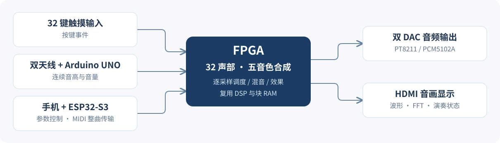

# 弦动智音

> 基于 FPGA 的实时多音色电子乐器，让触摸琴键与空中演奏在同一套硬件中合奏。

**32 复音 · 五种音色 · 特雷门琴 · 手机交互 · 音画联动**

[快速开始](docs/BUILD_AND_PROGRAM.md) · [硬件接线](docs/CURRENT_INTERFACES.md) · [下载固件](release/v21_20261103/README.md)

## 演奏与交互

- **两种演奏输入**：32 键触摸琴键与双天线特雷门琴，支持独奏和合奏。
- **五种合成音色**：钢琴、管风琴、长笛、吉他、钟琴，全部由 FPGA 实时生成。
- **演奏表现**：滑音、颤音、音量与速度调节；音色切换采用淡出、声部清理和淡入。
- **手机控制**：Wi-Fi 网页与 BLE 交互，支持参数设置、键位配置、MIDI 整曲演奏和指导模式。
- **音画联动**：双 DAC 音频输出，HDMI 显示波形、FFT 频谱与演奏状态。

滑音与颤音适用于钢琴、管风琴、长笛和钟琴。多轨曲谱统一使用当前选择的音色。

## 核心设计

| 能力 | 实现 |
|---|---|
| 32 声部合成 | 声部独立维护音高与包络，分时复用 DSP 运算资源 |
| 多音色引擎 | 加法合成、Karplus–Strong 延迟反馈、FM 合成 |
| 标称 48 kHz 音频 | 内部 24 位，PT8211 / PCM5102A 双 DAC 输出 |
| 1080p 可视化 | 1920×1080、30 Hz 视频，2048 点 FFT |

## 三端工程

| 工程 | 硬件 | 源码入口 |
|---|---|---|
| FPGA 合成与显示 | Tang Mega 138K Pro | [高云工程](yinyue_fashengqi.gprj) · [RTL](src/) |
| 手机交互与曲谱 | ESP32-S3 N32R16V | [Arduino 工程](firmware/remote_music_ble/esp32/ESP32_FPGA_Music_Controller/) · [网页](firmware/remote_music_ble/shouji/) |
| 特雷门琴采集 | Arduino UNO + Open.Theremin V3 | [Arduino 工程与校准说明](firmware/theremin/README.md) |

## 上手演奏

1. 按 [构建与烧录说明](docs/BUILD_AND_PROGRAM.md) 加载三端配套程序；FPGA 固件先解压 ZIP，ESP32 合并固件烧录地址为 **0x0**。
2. 连接 `FPGA_MUSIC` 热点，打开 `http://192.168.4.1`，选择音色和演奏方式。
3. 自动演奏时导入 [多音轨《卡农》](scores/卡农_最新ESP32_20261103/)，选择全部旋律音轨，点击 **“传入设备”**，确认整曲缓存完成后播放。

## 进一步了解

- [合成算法与系统架构](docs/ARCHITECTURE.md)
- [构建、烧录与使用](docs/BUILD_AND_PROGRAM.md)
- [硬件接线与通信协议](docs/CURRENT_INTERFACES.md)
- [验证方法与开发说明](docs/DEVELOPMENT.md)
- [当前固件、时序报告与校验清单](release/v21_20261103/README.md)

当前版本 **V21 / 2026-11-03**。FPGA 已完成综合、布局布线和五类静态时序检查；编译及数字仿真记录见发布目录，实板性能以测量结果为准。

第三方代码保留原作者署名与许可证，详见 [来源与许可说明](third_party/README.md)。
