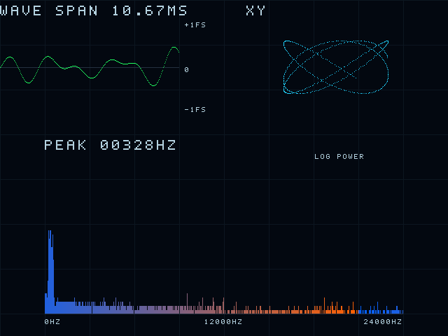
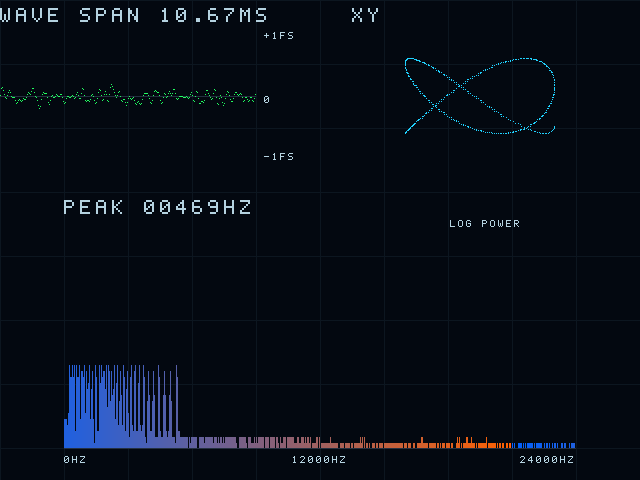

# 发布前完整回归（含ADC、音频、FFT、显示和双DAC）

状态：**PASS**。2026-10-09北京时间13:49:35至14:15:14，耗时1539.234秒；入口实际退出码0，五suite全部通过。84个src/sim/scripts文件在运行前后SHA256一致。完整数据及原始工作区/规范LF源码哈希见[机器报告](full_regression_20261009.json)。旧日期/专项报告保留，不作为本轮替代证据。

入口：`scripts/run_visual_tests.ps1`，依次执行工具链迁移自检、双MCP3208独立采集、当前合成音频质量、完整显示/FFT/TMDS、双DAC五个suite。源码运行前后SHA256必须一致。

本轮不新增功能，不改PLL/CST/SDC或物理串行器，不接入ADC管脚/声音控制。最终报告须区分当前板级工程约定回归、旧根目录独立基线及硬件验收，不能将仿真通过称为实际布局布线/模拟DAC/HDMI线缆验收。

## 本次完整运行结果

| Suite | 实际结果 |
|---|---|
| test_toolchain.py | PASS：工具发现、带空格路径迁移、覆盖配置与缺失工具报错 |
| verify_adc.py | PASS：660个双ADC数据帧、321个通道对、30000存储测试周期、3项非法参数保护；4配置严格lint零warning，3模块Yosys零问题，无运行时除法/锁存器 |
| verify_audio_quality.py | PASS：4/8/16/32 Voice、16/24bit等24配置共28800增益输出bit-exact；4352波形相位、9216缩放边界；13场景53888真实合成样本零满幅削顶；FIFO depth1/3/16随机反压/复位；24bit WAV往返；严格增益lint零warning、Yosys零问题 |
| verify_visual.py | PASS：1024/2048/4096点共14336个复数/功率bin逐位一致，各配置32/32峰；CDC、单侧复位、视频帧时序、读数、TMDS故障注入；4/32 Voice完整链分别还原307200像素；visualizer/test_mode严格lint零warning，Yosys零问题 |
| verify_pcm5102a.py | PASS：I2S逐bit、双DAC、真实合成链；PT8211时序与备份一致；PCM sender严格lint零warning、Yosys零问题；原三GPIO约束核对通过 |

真实32 Voice→DAC数字PCM→RTL FFT→512柱频谱：32/32独立峰，2048个复数/功率bin逐位比对；5644个捕获样本削顶率0%。DDS ROM理论量化最大误差0.000005408Hz；2048点FFT读数最大栅格误差12.020455Hz（48kHz下bin宽23.4375Hz），两者不是同一种误差。实际主峰读数469Hz。

I2S在名义12.288MHz输入下直接测得BCLK周期4个输入时钟，即3.072MHz；LRCLK周期256个输入时钟，即48kHz。覆盖WS后1bit MSB延迟、24bit在32bit slot内对齐和连续帧。PLL实际频率/锁定未实测。

## 发布内容与修改原因

- `src/polyphony_gain.v`及core/frontend/top参数贯通：修复Voice数量增加时历史增益下降过慢，立即限制安全上限；master默认0.9并慢恢复。旧512样本fixture的8个削顶点变为0，原始混音/Voice数量保持一致，单音不除32。
- `src/test_mode.v`、`audio_visualizer.sv`、`visual_renderer.sv`、`visual_labels.sv`及GPRJ：真实32 Voice诊断频率间距、波形/频率标尺、主峰读数与绘图；未改声音状态独立性或物理视频封装。
- `sim/tb_visual_system.sv`、`tb_visual_readout.sv`、`tmds_stream_checker.sv`、`tb_tmds_receiver.sv`：实际PCM逐bin/柱高/读数比对、TMDS逆向接收、通道/bit/控制故障检出和整屏像素核对。
- `sim/tb_audio_quality.sv`、`tb_mix_gain.sv`、`tb_waveform_quality.sv`、`tb_note_fifo.sv`及fixture：增加复音/边界/velocity/Morph/复位/快速事件和前后增益自检。
- `src/mcp3208_dual_reader.sv`、`hall_scan_store.sv`、`hall_adc_scan.sv`及配套模型/TB：双MCP3208原始采集与16键数据存储，仍为未接板独立层，不生成音符、不配置GPIO。
- `scripts/toolchain.py`、`run_regression.py`、`run_checks.ps1`、各verify脚本、工具迁移测试、`pcm_to_wav.py`和requirements：可移植工具发现、统一五suite失败即退出、源码冻结证明、PCM开发期导出。
- README与verification：区分当前板级工程/旧基线、历史/本次证据、仿真/硬件边界，归档本轮结果而非上传临时产物。

通用视觉综合统计为12个memory cell/10个multiply cell，先前仅显示基线为11/8；增加了当前读数/标尺功能，不能把通用cell当成Gowin BRAM/DSP数量。增益模块只有1个通用乘法器、无运行时除法；ADC三模块无运行时div/mod或锁存器。未完成厂商映射，不声称整板资源下降或布局布线通过。

## 本轮TMDS还原图

以下由RTL最终三路10bit TMDS字逆向解码得到，不是UI概念图；与原像素逐字节一致。图片SHA256在机器报告中。

四Voice：

32 Voice：

## 未覆盖与上板事项

本轮完整指当前板级统一入口五suite，不是根目录旧基线全套重跑，也不宣称整个含厂商原语顶层零warning。上述严格lint对象无warning且未靠Wno-fatal或lint_off隐藏问题。

TMDS核对在OSER10之前；还需Gowin综合/布局布线、实际RAM/DSP映射与时序、PLL/OSER10/差分电气、25MHz像素时钟的屏幕兼容性、双DAC模拟输出/听感、ADC供电电平与接线、脱离电脑冷启动。ADC没有可靠应答，stale不等于断线检测。24bit格式也不等于24bit有效音质。

FFT采样窗口默认42.7ms不在声音输出串行路径上；本轮没有实测传感器→DAC模拟输出的数字/模拟总延迟，不能据此宣称达到≤5ms。内部计数、仿真频率和Python分析均不替代硬件测量。
