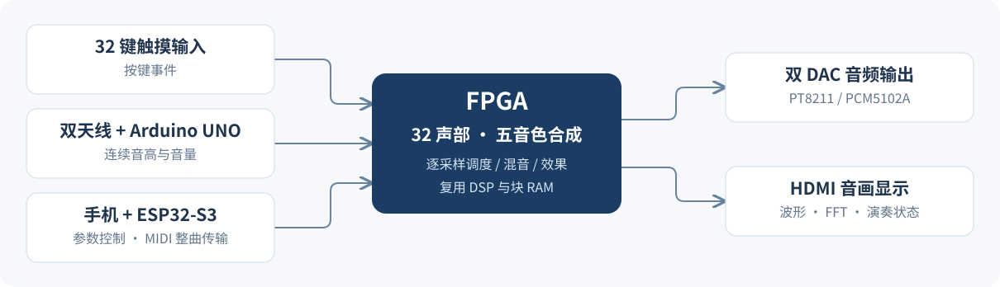

# 系统架构与合成方法

## 三端分工

FPGA 负责逐采样合成、声部分配、效果处理、混音、双 DAC 输出和视频显示。ESP32 负责手机网页、BLE、参数回读与整曲缓存；它发送起音/松音事件，音频由 FPGA 生成。UNO 负责双天线测量、校准、旋钮和状态采集，向 FPGA 发送连续频率与幅度。

琴键、特雷门琴与合奏是三种声源模式；自由演奏、自动演奏、指导模式是手机选择的演奏方式。两者分别管理，接口见 [通信说明](CURRENT_INTERFACES.md)。

## 音色算法

| 音色 | 合成方法 |
|---|---|
| 钢琴 | 15 个独立频率的正弦分音与击槌噪声；各分音具有随时间变化的幅度包络 |
| 管风琴 | 按音栓权重叠加不同倍频的分音 |
| 简化长笛 | 基音、较弱的二/三次谐波与低电平气息噪声 |
| 吉他 | Karplus–Strong 噪声激励、延迟反馈、损耗滤波和分数延迟调音 |
| 钟琴 | 载波/调制波 FM 合成，配合独立调制衰减 |

特雷门琴使用独立正弦 DDS 音源，控制频率为 20～4000 Hz；FPGA 平滑目标音高与幅度，不按 MIDI 半音量化。UNO 本地波表音色不等同于 FPGA 特雷门琴音色。

## 复音、DSP 与存储

32 个逻辑声部独立维护相位、目标音高和包络。钢琴按分音时隙复用乘法器，每个声部的参数、相位与包络状态存放在声部 RAM 中；每个采样周期完成运算后再输出混音结果。

辅助音色采用四条运算通道，每条调度八个声部上下文。吉他每声部的 24 位延迟数据采用配对打包方式进入块 RAM；滑音控制器的当前值和待更新值也使用块 RAM，减少逻辑寄存器占用。初始化数据位于 [assets/](../assets/)，属于构建依赖。

标称音频采样率 48 kHz，内部 24 位；板载 PT8211 输出 16 位，外接 PCM5102A 输出 24 位。视频输出为 1920×1080、30 Hz，并进行 2048 点 FFT 分析。

## 音色切换与演奏表现

音色切换依次执行淡出、清理旧声部与效果、等待清理确认、提交新音色、淡入；单侧淡变约 5.3 ms。切换时已经按住的琴键需释放后重新触发。

钢琴、管风琴、长笛、钟琴支持 0～100 的滑音与颤音参数；每声部独立滑音，共享约 5 Hz 三角 LFO。滑音起点来自前一个接受的音符，覆盖 ±60 半音；首音和更大跳音直接使用目标音高。吉他与特雷门琴不使用这两个手机参数；“力度”参数目前只保存和回读。

特雷门琴接收端检查帧格式、CRC、序号和传感状态；100 ms 失联后淡出，连续三帧有效新数据后恢复。合奏中只处理特雷门琴支路，琴键声部继续运行。

## 曲谱与验证范围

网页支持 MIDI 0/1 与顺序单旋律 JSON；整曲多轨时间线由 ESP32 缓存并按 FPGA FIFO 余量供谱。同音高跨轨重叠按引用计数合并；所有音轨使用当前选中的同一种音色，不导入踏板、弯音、程序音色指令和中途变速。指导模式使用单旋律分段。

32 复音和以上参数属于设计配置。数字回归包含实际声部库、混音、效果与双 DAC 链路；关闭效果的 21,911 帧与 V20 基线一致，开启效果的 21,913 帧通过检查。音频回归使用 ROM/PLL 模型、关闭显示，并以三音和弦及独立松音测试，不能视作实板 32 键同时发声或端到端延迟测量。

48 kHz 对应的约 20.8 μs 采样间隔不等同于触摸到扬声器的总延迟。时序与资源数据见 [当前发布记录](../release/v21_20261103/README.md)。
