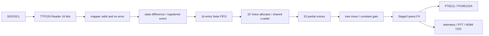

# AUDIO_SIGNAL_CHAIN

工作工程：`D:\gaoyun\piano_v2_audio_fix`

工程入口：`D:\gaoyun\piano_v2_audio_fix\yinyue_fashengqi.gprj`

更新：2026-10-17T19:15:59.244408+08:00；本轮记录目录：`D:\gaoyun\piano_v2_audio_fix\audit\continuation_20261017`、`D:\gaoyun\piano_v2_audio_fix\tests\continuation_20261017`。

验证层次：源码审查及依赖哈希已留证（PATH_VERSION_AUDIT.json）；本轮仿真/数据核对=PASS；Gowin实现=PASS；真实上板=未执行，协议、实体键位及模拟音频仍待验证。

实际默认参数：BUILD_STAGE=3、DISPLAY_ENABLE=1、KEYBOARD_PROFILE=0、KEY_RAW_MAP_ENABLE=0、KEY_MAPPING_CONFIRMED=0；固定velocity100；32 Voice、FIFO16、48kHz、音频每256拍取样。50MHz板级时钟、PLL 29/118生成约12.288MHz，SDC未改。

## 源码审查

- Reader使用5位bit_index，0..15共16次；每一完整帧在bit15完成时发布。高4位没有12键边界。CONFIRM=1逐位要求两帧一致；默认SAMPLE_LOW=0，在SCL高相末端采样同步后的SDO。
- 默认STRICT_IDLE=1拒绝SDO持续有效电平。MIRROR_GUARD=1在未见上下字节不同的确认帧时屏蔽上字节；F000单独按下可证明16位并解除保护。首次FFFF或0101等对称和弦可能被屏蔽上字节；这是模型已复现的保守策略限制，不是照片所示单个高位被接纳后无声的证实根因。未未经实物确认关闭保护或切换I²C。
- mapper只在frame_valid && !frame_error && !mapping_error时更新key_state和accepted_raw；输出valid由非阻塞赋值产生，下游在下一拍读取稳定的整帧；16位保持完整。
- Bridge的reported_state表示已排入其输出寄存器的状态。真正接受点是event_valid && event_ready；背压时负载保持，Off优先，再发On。短于两帧确认窗口的触摸可能不被接纳，不承诺捕获每个模拟短脉冲。
- FIFO只有in_valid&&in_ready才写，out_valid&&core_ready才读；满时停写，保持事件次序，没有越过满状态静默覆盖。满且同拍读时会留一拍写入空隙，属于吞吐限制。
- core_ready=!ld_busy，Loader忙时On和Off均不出队；Allocator选择空闲、释放中、再抢占Voice。Loader锁存MIDI、velocity及基础相位增量，写400字/音后对所选Voice发ld_done。
- Voice在V_LOAD接收ld_done后进入V_PLAY；active包含LOAD/FADE/PLAY，故active非零不等于已经输出PCM。stop可以在加载/播放期间设置释放；新start优先。32条独立Voice RAM和调度均保留。
- MIDI60..75在有效区间；Loader将超出24..104的音色索引钳位，频率表仍按实际MIDI。MIDI参数不依赖实体键号。原旧表也是16个唯一有效音，不能单凭其排列解释四键全部零Voice。

## 仿真覆盖层级

直接注入事件：原钢琴Voice/Loader、系统、抢占/重触发、短按/加载中释放、长音与FX回归。mapper输入注入：keyboard_events，覆盖16键、和弦2/3/5/8/16、独立松键、快速切换、无效帧、FIFO满背压及复位。模拟串行SDO：逐键mapping、默认stress、high_chord和mirror_policy，真实Reader/mapper/FIFO/32Voice/FX连接。仿真BFM假定TTP229-BSF式低有效16键串行；不等于BIT-TREE实物协议已确认。

## 无声定位与诊断语义

原测试两周期定向失败：数据0、补零0、帧长度1、I²S延迟0，同时5152帧数据匹配、4482帧非零。接收模型没有reset输入，原逐键测试复位发射器却未调用pcm_check.restart，导致下一段首帧拼接上段残留右声道半帧。A/B同波形中正确调用restart的检查器全部0错。修复在每次DUT复位前调用现有restart任务；累计错误计数保留，末尾原PCM断言保留，并增加双声道PT8211、非零样本和覆盖检查。4096采样保持窗口长于原2048，覆盖50ms HDMI峰值发布，不以删断言、降低阈值或缩短完整16键测试制造PASS。

新增diagnostic_chain是可综合、复位后累计的真实观测，RTL内部16位计数模65536；最终GAO只捕获计数的低8位，按模256取差值，并保留完整24位峰值。GAO采样4096点、clk_12m288，约333us，可覆盖单键Loader约203us的加载；持续计数用于跨捕获查看。每键复位最容易判读；连续累计超过255次须按(after-before)&255取差，不能把低8位当无界总数。计数不是丢失计数或装饰值。FX前峰值取归一化混音饱和到24位后的幅值（大合奏可能饱和），FX后峰值取真实audio_out；均在sample_tick采样，直到复位保留，不能当作RMS或50ms窗口峰值。

|GAO diagnostic_chain位段|含义|
|---|---|
|7:0|Allocator接受分配/start脉冲次数，低8位|
|23:16|Loader ld_done次数，低8位|
|39:32|ld_done且Voice处于V_LOAD/引擎空闲的就绪完成次数，低8位|
|71:48|FX前累计绝对峰值|
|95:72|FX后累计绝对峰值|
|103:96|FIFO真正读出的Note On数，低8位|
|119:112|FIFO真正读出的Note Off数，低8位|

顶层key_note_on_count/key_note_off_count为FIFO真正写入计数；key_last_accepted_midi只在valid&&ready更新，key_frame_count为mapper接受帧数，key_stall_count为背压连续区段次数，key_rejected_frames记录Reader错误/mapper拒绝；这些计数均捕获低8位，MIDI保留完整7位。背压次数非零不代表丢事件。分配计数同拍产生实际Voice start脉冲；就绪完成只表示ld_done时的加载就绪条件，同拍若又发生新start，须按Voice控制优先级结合实际active和PCM判读，不能单凭此计数宣称可听播放。逐键复位后唯一Voice的非零PCM另行证明已经进入实际播放。

HDMI VOICE来自audio_telemetry对真实active_debug计数；PEAK是每2400个sample_tick发布的50ms绝对峰值。状态58位经request/ack稳定捆绑邮箱，在vblank更新；会有显示延迟。MIDI由最低被接纳key_state组合映射而来，不是最后已接受的FIFO事件，因此单看音名不证明Note On被处理。FFT/显示复位与音频就绪解耦。

物理DVI边界现为每通道一个syn_preserve/syn_keep局部复位寄存器，异步断言、像素边沿同步释放，额外一像素周期复位延迟（约40ns），不改变数据/时钟/管脚或音频。dvi_local_reset检查四种相位的断言/释放与连线；dvi_vendor使用真实Gowin OSER10/ELVDS行为模型，对动态RGB和重复复位的3000次DDR输出与原连线作有效复位对齐比较。便携整机仿真替换物理串行器边界，这项新RTL由上述专门测试、真实原语展开和最终Gowin时序另行覆盖，不把旧边界模型当作新物理边界已上板验证。

