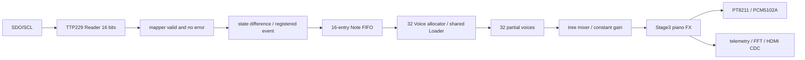

# KEYBOARD_MODULE_MAP

工作工程：`D:\gaoyun\piano_v2_audio_fix`

工程入口：`D:\gaoyun\piano_v2_audio_fix\yinyue_fashengqi.gprj`

更新：2026-10-17T19:15:59.254686+08:00；本轮记录目录：`D:\gaoyun\piano_v2_audio_fix\audit\continuation_20261017`、`D:\gaoyun\piano_v2_audio_fix\tests\continuation_20261017`。

验证层次：源码审查及依赖哈希已留证（PATH_VERSION_AUDIT.json）；本轮仿真/数据核对=PASS；Gowin实现=PASS；真实上板=未执行，协议、实体键位及模拟音频仍待验证。

实际默认参数：BUILD_STAGE=3、DISPLAY_ENABLE=1、KEYBOARD_PROFILE=0、KEY_RAW_MAP_ENABLE=0、KEY_MAPPING_CONFIRMED=0；固定velocity100；32 Voice、FIFO16、48kHz、音频每256拍取样。50MHz板级时钟、PLL 29/118生成约12.288MHz，SDC未改。

|模块 / 当前源码|职责 / 本轮变化|
|---|---|
|`D:\gaoyun\piano_v2_audio_fix\src\tang_mega_138k_pro_top.v.v`|Reader、mapper、Bridge、板级复位、显示连接；新增真实接受MIDI/帧/背压诊断|
|`D:\gaoyun\piano_v2_audio_fix\src\ttp229_reader.v`|16位串行读帧、两帧确认、镜像保护；未改|
|`D:\gaoyun\piano_v2_audio_fix\src\keyboard\keyboard_state_mapper.sv`|整帧接纳和位序映射；未改|
|`D:\gaoyun\piano_v2_audio_fix\src\ttp229_event_bridge.v`|状态差分、保持背压负载；未改|
|`D:\gaoyun\piano_v2_audio_fix\src\note_event_fifo.v`|16项事件FIFO；未改|
|`D:\gaoyun\piano_v2_audio_fix\src\synth_event_frontend.v`|FIFO就绪到Core；新增实际出队计数|
|`D:\gaoyun\piano_v2_audio_fix\src\voice_allocator.v`|固定32 Voice分配/抢占；未改|
|`D:\gaoyun\piano_v2_audio_fix\src\voice_bank.v`|共享Loader与32Voice；新增分配、加载、播放计数|
|`D:\gaoyun\piano_v2_audio_fix\src\piano_note_loader.v`|AMY参数插值及400字RAM加载；算法未改|
|`D:\gaoyun\piano_v2_audio_fix\src\piano_partial_voice.v`|每音15泛音+Hammer、包络/相位/乘累加；未改|
|`D:\gaoyun\piano_v2_audio_fix\src\synth_core.v`|Mixer/增益/FX/遥测；新增真实前后累计峰值|
|`D:\gaoyun\piano_v2_audio_fix\src\synth_top.v`|音频链、双DAC；透传诊断|
|`D:\gaoyun\piano_v2_audio_fix\src\piano_fx_compat.v`|包含当前src/piano_fx.v，后者在gprj中禁独立编译以免重复|
|`D:\gaoyun\piano_v2_audio_fix\src\i2s_tx.v`|PT8211 16位双声道、sample_tick源；未改|
|`D:\gaoyun\piano_v2_audio_fix\src\pcm5102_i2s_tx.v`|24位标准I²S、每通道32位；未改|
|`D:\gaoyun\piano_v2_audio_fix\src\display\piano_status_cdc.v`|真实状态request/ack邮箱；未改|
|`D:\gaoyun\piano_v2_audio_fix\src\keyboard_debug.rao`|保留旧探针并增加128位链诊断、MIDI、帧、拒绝/背压计数|

自动源图、63个有效条目+1个include、65个唯一模块：`D:\gaoyun\piano_v2_audio_fix\audit\continuation_20261017\PATH_VERSION_AUDIT.json`。源图保守包含generate的备用分支，实际默认分支由完整顶层层级断言及Gowin检查。所有生产ROM在当前src初始化，不从旧目录读取ROM。audio_pll.mod中的旧生成路径未列入工程依赖，未运行IP重生成。

物理DVI边界 `D:\gaoyun\piano_v2_audio_fix\src\display\visual_dvi_io.v`：新增三条通道各自的局部复位寄存器（u_video_io/channels[i].local_rst_n），异步断言、同一像素边沿释放，RGB位序及差分输出连接不变。专门复位测试、真实Gowin行为模型对照与原语展开均有独立日志，最终时序以当前BUILD.json为准。

